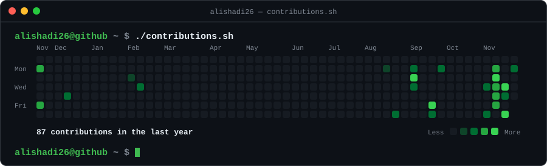
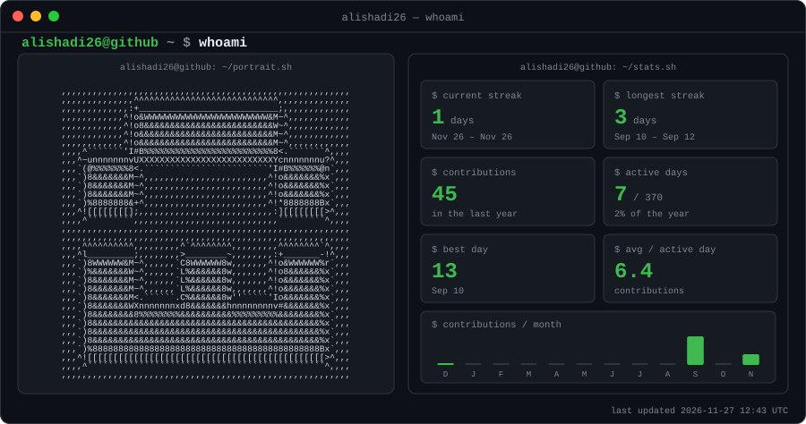

<div align="center">





</div>

```bash
alishadi26@github ~ $ cat about.txt
```
```yaml
name       : Ali Shadi
role       : Computer Science student @ AASTMT · Cairo, Egypt
graduating : 2028
focus      : cybersecurity · AI / ML · software engineering
languages  : C · C++ · Python · Java · HTML/CSS
currently  : training for ECPC (C++) · building with the Gemini API · GDG On Campus Robotics
previously : AI Data & Software Evaluation, Labelbox (remote, 2026)
open to    : software engineering & research internships, summer 2027
```

```bash
alishadi26@github ~ $ ls ./projects
```

| Project | Stack | What it is |
|---|---|---|
| [🛡️ cybersecurity-labs](https://github.com/Alishadi26/cybersecurity-labs) | Python | From-scratch pcap/pcapng analyzer that catches cleartext passwords, plus a port scanner, file integrity monitor, password auditor and 5 Kali/Wireshark labs |
| [🏆 ecpc-training](https://github.com/Alishadi26/ecpc-training) | C++ | My ICPC team notebook: 25+ algorithms, each tested against brute force with sanitizers on |
| [☕ java-oop](https://github.com/Alishadi26/java-oop) | Java | 5 OOP projects (bank system, library management, shapes…) with UML and 48 test checks |
| [🐍 Terminal Snake](https://github.com/Alishadi26/Alis-c-projects/tree/main/snake-game) | C++ | Real-time Snake game in the terminal, with raw input and ANSI colors |
| [🤖 Gemini Chatbot](https://github.com/Alishadi26/Alis-Python-Projects/tree/main/gemini-chatbot) | Python | CLI chatbot with conversation memory on Google's Gemini API |
| [🌐 Personal Website](https://github.com/Alishadi26/Web-playground) | HTML · CSS | Hand-written multi-page site, no frameworks |
| [💱 Currency Calculator](https://github.com/Alishadi26/Alis-c-projects/tree/main/currency-calculator) | C | EGP/EUR/USD converter and calculator with input validation |

```bash
alishadi26@github ~ $ ./links.sh
```

<p>
  <a href="https://alishadi26.github.io/Web-playground/"></a>
  <a href="https://www.linkedin.com/in/ali-shadi-3513a53a0"></a>
  <a href="mailto:alishadi2606@gmail.com"></a>
  <a href="https://github.com/Alishadi26?tab=repositories"></a>
</p>

<sub>The panels above are regenerated every day by a GitHub Action (<a href="scripts/generate.py">scripts/generate.py</a>).</sub>
